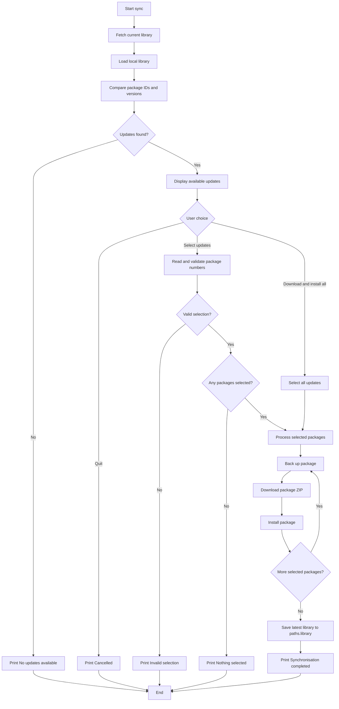
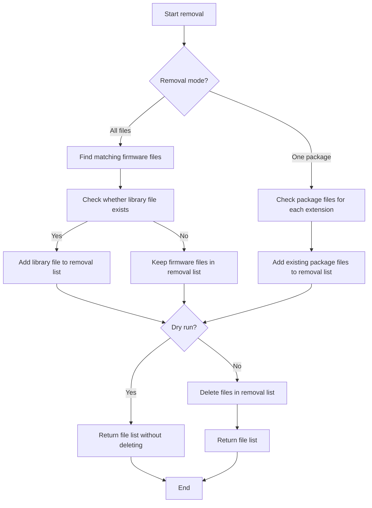
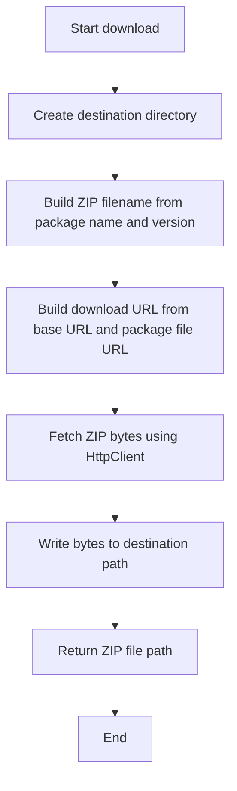
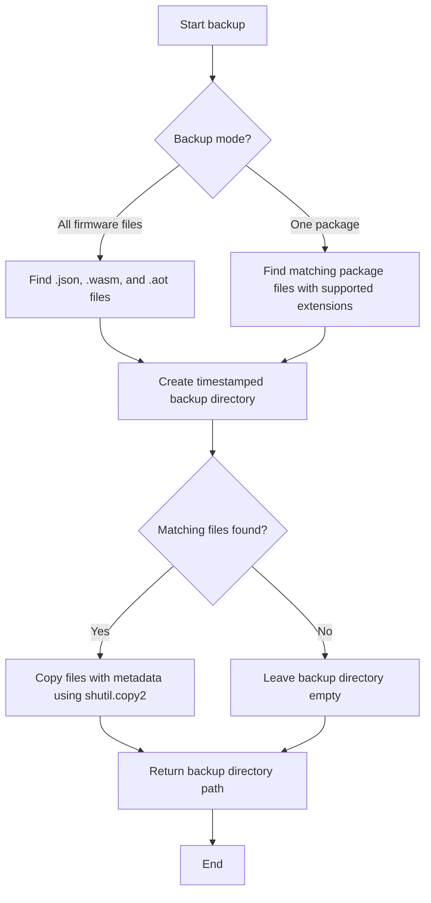

# VIBE Firmware Manager

Firmware download and installation manager for VIBE FM firmware packages.

The application connects to The Firmware Hub, downloads available firmware packages, stores them locally and installs firmware files into the VIBE FM Firmware directory.

---

## Features
✅ Sync firmware packages

✅ Download firmware packages

✅ Cache downloads locally

✅ Install downloaded firmware

✅ Backup existing firmware before updates

✅ Force download all firmware packages

✅ Force reinstall all firmware packages

✅ Remove all

✅ Offline installation from cached packages

✅ Command line interface

---

## Installation

### From PyPI

```bash
pip install vibe-firmware-manager
```

---

## Usage

Show help:

```bash
vibe-fw --help
```
Download sync firmware packages:

Checks against the library.json which is saved locally to se if there are any updates.

```bash
vibe-fw sync
```

Download available firmware packages:

Downloads all of the firmware packages.

```bash
vibe-fw download
```

Install previously downloaded firmware:

Installs all packages in the downloads folder.

```bash
vibe-fw install
```

Download and reinstall everything:

Force a removal of everything and adds the latest firmware and library.json

```bash
vibe-fw force
```

Remove:

All:

Removes all the firmware in the firmware folder and the library,json

```bash
vibe-fw remove
```

Dry run:

```bash
vibe-fw remove --dry-run
```

A package:

```bash
vibe-fw remove --package funkydunky
```


---

## Application Folders

The application stores all firmware data under:

```text
%APPDATA%\VIBE FM
```

Directory structure:

```text
VIBE FM
│
├── library.json
│
├── Downloads
│   ├── PackageA-1.0.zip
│   ├── PackageB-1.2.zip
│   └── PackageC-4.0.zip
│
├── Firmware
│   ├── PackageA.json
│   ├── PackageA.wasm
│   └── PackageA.aot
│
└── Backup
    ├── 20261101-120000
    └── 20261101-133000
```

---
## Sync process

1. **Fetch the current library** using `LibraryService.get_library()`.
2. **Load the local library file** from `paths.library`. If it contains a dictionary, the service reads its `"library"` list; it also supports a top-level list.
3. **Compare versions** by package ID. A package needs an update if it isn’t in the local library or its installed version differs from the available version.
4. **Handle the no-update case:** print “No updates available.” and stop.
5. **Ask what to update:** quit, select all updates, or enter package numbers. Invalid input or an empty selection stops the process.
6. **Process each selected package:** back up its existing firmware files, download the package ZIP, then install it into the firmware directory.
7. **Save the latest library data** to `paths.library` after all selected packages have been processed.
8. **Report completion** by printing “Synchronisation completed.”

## Sync flowchart



## Removal process

1. **Choose the removal mode:**
   - Remove all matching firmware files and the library file using `remove_files()`.
   - Remove only one package’s matching firmware files using `remove_package_files()`.
2. **Find matching files:** the service looks for `.json`, `.wasm`, and `.aot` files in the firmware directory.
3. **Include the library file:** in all-files mode, `library_file` is included if it exists. Package-specific removal does not affect the library file.
4. **Preview or delete:** with `dry_run=True` (the default), the service returns the matching file paths without deleting them. With `dry_run=False`, it deletes the selected files.
5. **Return the paths:** both methods return a list of files selected for removal, whether or not they were actually deleted.

## Removal flowchart



## Download Process

Downloaded ZIP files are stored in:

```text
%APPDATA%\VIBE FM\Downloads
```

The service retains downloaded ZIP files so firmware can be installed later without downloading them again. If a ZIP with the same package name and version already exists, the download overwrites it.

1. **Ensure the destination exists:** create the destination directory and any missing parent directories.
2. **Build the ZIP file path:** use the package name and version in the filename: `{package.name}-{package.version}.zip`.
3. **Build the download URL:** combine `base_url` with `package.file_url`, removing any leading slash from `package.file_url`.
4. **Fetch and save the file:** request the ZIP’s bytes through `HttpClient` and write them to the destination path.
5. **Return the path:** return the path to the saved ZIP file.

## Download Flowchart


---

## Supported Firmware Files

Only the following file types will be installed:

```text
.json
.wasm
.aot
```

All other files contained within firmware packages are ignored.

---

## Backup Process

Before replacing firmware files, the current firmware files can be backed up to a timestamped directory under the backup root.

Example:

```text
Backup
└── 20261101-120000
    ├── SynthOne.json
    ├── SynthOne.wasm
    └── SynthOne.aot
```

The service supports two backup modes:

1. **Back up all firmware files:** `create_backup()` copies every `.json`, `.wasm`, and `.aot` file in the firmware directory.
2. **Back up one package:** `create_package_backup()` copies only the matching files for the specified package, if they exist.
3. **Create a timestamped folder:** both methods create a folder named with the current date and time in `YYYYMMDD-HHMMSS` format.
4. **Preserve file metadata:** `shutil.copy2()` copies each file and its metadata.
5. **Return the backup path:** each method returns the path to the created backup directory.

This backup can be used to restore firmware files if a rollback is needed.

## Backup Flowchart


---

## Force Install

Force Install performs the following steps:

```text
1. Download all firmware packages
2. Backup current firmware
3. Remove existing firmware files
4. Reinstall all downloaded firmware
```

Files removed during force install:

```text
*.json
*.wasm
*.aot
```

---

## Development

Clone repository:

```bash
git clone https://github.com/kesi03/vibe-firmware-manager.git
```

Create virtual environment:

```bash
python -m venv .venv
```

Activate virtual environment:

Windows:

```bash
.venv\Scripts\activate
```

Install editable package:

```bash
pip install -e .
```

Run directly:

```bash
python -m vibe_firmware download
```

---

## Running Tests

```bash
pytest
```

---

## License

MIT License